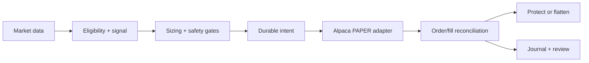

# ORB-IEX — paper-trading engineering

My Python port of a reference opening-range breakout strategy for Alpaca’s paper environment. The engineering focus is **order ownership, ambiguous broker responses, reconciliation, protective orders, and restart recovery**.

**Documentation only:** implementation, broker records, runtime journals, credentials, and research files remain private. This repository cannot trade and contains no performance or profitability claim.

## Implemented architecture

| Layer | Responsibility |
| --- | --- |
| Strategy | Opening-range signals, eligibility filters, sizing, and exposure checks. |
| Broker adapter | Deterministic client order IDs, lookup after uncertain responses, and cancellation confirmation. |
| Recovery | Reconcile broker state with durable intent; manage partial fills and protection; block entries on safety failures. |
| Persistence | SQLite order/fill state and separate journal/export records. |
| Operations | Heartbeat, health checks, circuit breakers, and supervised paper operation. |



The adapter uses paper endpoints and ownership checks. A timeout is not proof an order failed: recovery must inspect existing orders before another submission.

## Verification

On 2026-10-20, in the private working tree with its existing environment:

```sh
cd orb_iex
.venv/bin/python -m pytest tests/unit/test_config.py tests/unit/test_safety.py tests/unit/test_account_safety.py tests/unit/test_reconcile.py tests/unit/test_recovery.py tests/unit/test_ambiguous_broker.py tests/unit/test_broker_safety.py -q
```

**142 passed, 1 failed.** The historical reconciliation test expects a fixed old count but reads an evolving local runtime journal. It needs an immutable synthetic fixture before the suite can be called reproducible. This audit changed neither the test nor the running bot.

Coverage includes paper configuration, foreign orders, account safety, partial fills, uncertain broker outcomes, and restart recovery. Offline tests do not establish uninterrupted operation or execution quality.

## Setup boundary

There is no public installation or bot test command in this documentation-only repository. The command above records a private audit; it cannot run after cloning this showcase. The private package declares Python 3.11+, requests, tzdata, and a pytest development extra. Focused offline tests need no keys. Broker-connected checks require a separate paper account and were not run here.

## Limitations and attribution

Paper fills and available data differ from real execution. Paper-account realized P/L, gross P/L, and modeled costs must remain distinct. No return, win-rate, Sharpe, or uptime is claimed. Full-suite and fresh broker/session validation remain outstanding. An in-progress journal dashboard is excluded from the verified functionality above.

This ports the supplied C# reference `reference/Main.cs`; I did not invent opening-range breakout. Development used substantial Claude and Codex assistance. Reference redistribution provenance is unresolved, so neither it nor the private repository history is republished.
